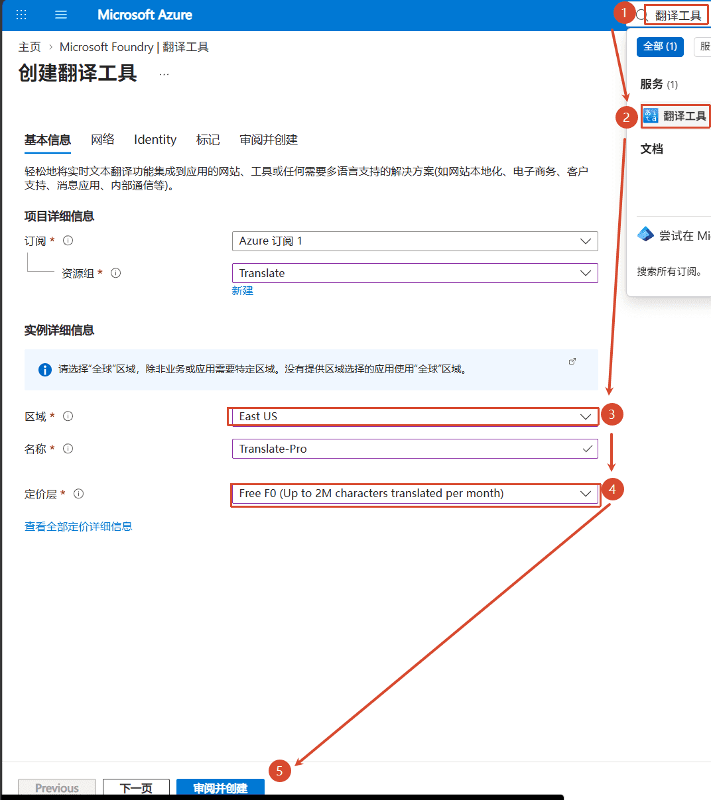
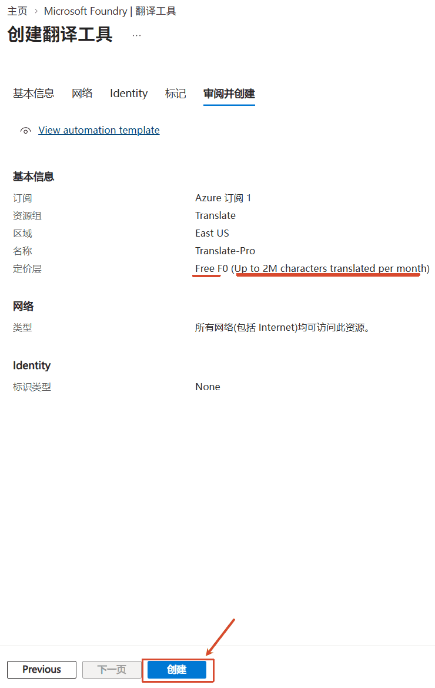
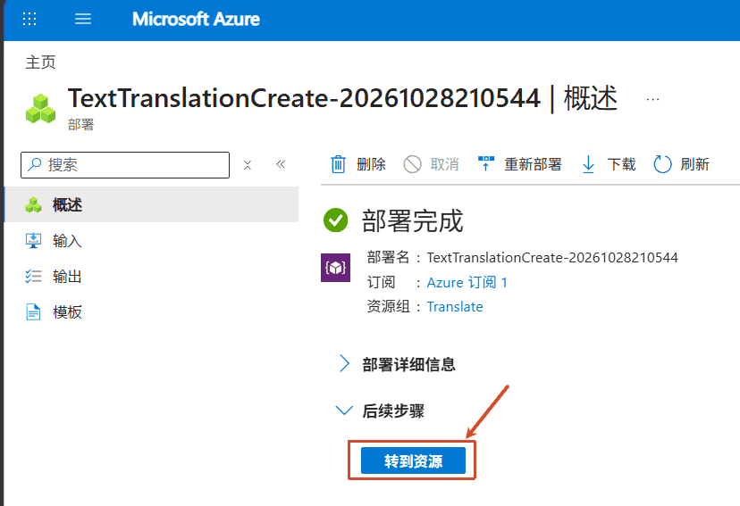
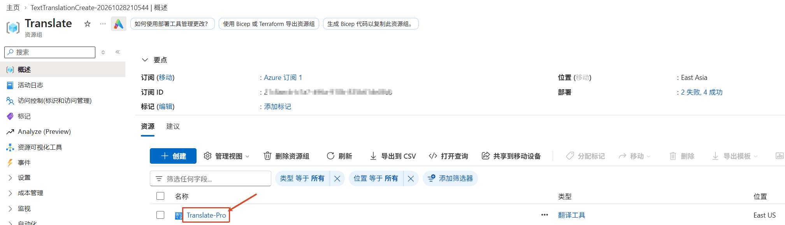
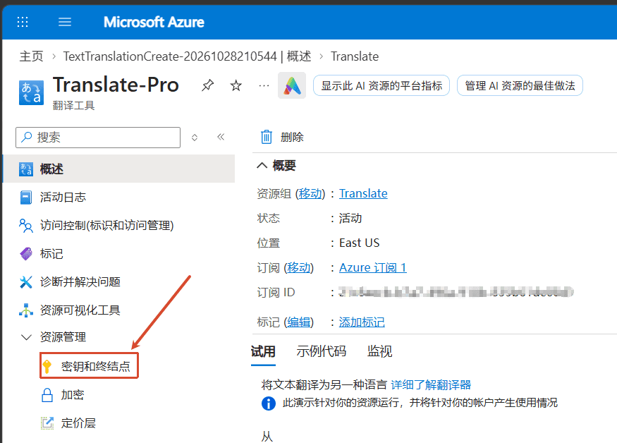
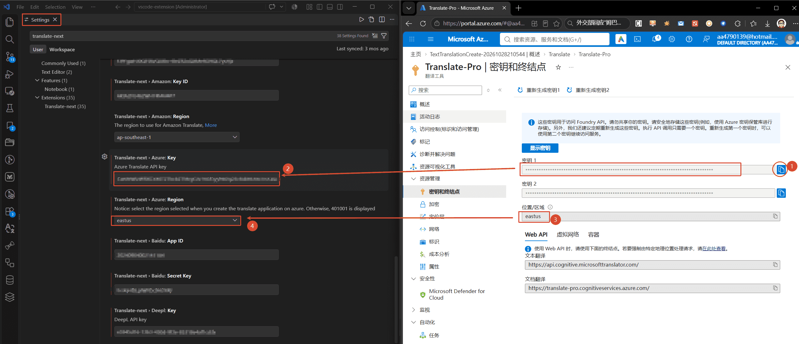

# Configure the Azure Machine Translation Engine

## Step 1: Register a Microsoft account
Sign-up page: [https://signup.live.com/signup](https://signup.live.com/signup)

## Step 2: Sign in to Microsoft Azure
Microsoft Azure portal: [https://portal.azure.com/](https://portal.azure.com/)

## Step 3: Create a `Translator` service

## Step 4: Open "Keys and Endpoint"
Copy the key and the location into the Azure configuration of the Translate-Pro settings:
`Translate-next.azure.key` and `Translate-next.azure.region`.

That's all — the Azure engine is ready to use.
