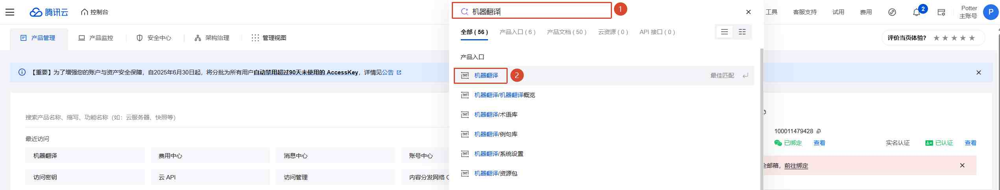
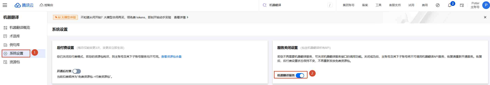
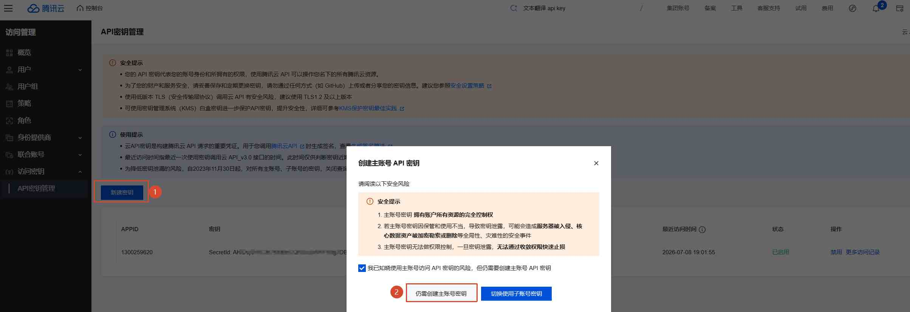
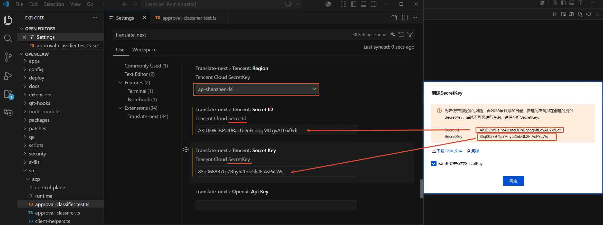

# Configure the Tencent Translation Engine

## Step 1: Register a Tencent Cloud account
Website: [https://console.cloud.tencent.com/](https://console.cloud.tencent.com/)

## Step 2: Activate machine translation

## Step 3: Create an API key
Shortcut: [https://console.cloud.tencent.com/cam/capi?__qcai_handover=nGANo4jE](https://console.cloud.tencent.com/cam/capi?__qcai_handover=nGANo4jE)

Copy the `secretId` / `secretKey` (and the region if needed) into `Translate-next.tencent.secretId`, `Translate-next.tencent.secretKey` and `Translate-next.tencent.region`.

That's all — the Tencent engine is ready to use.
