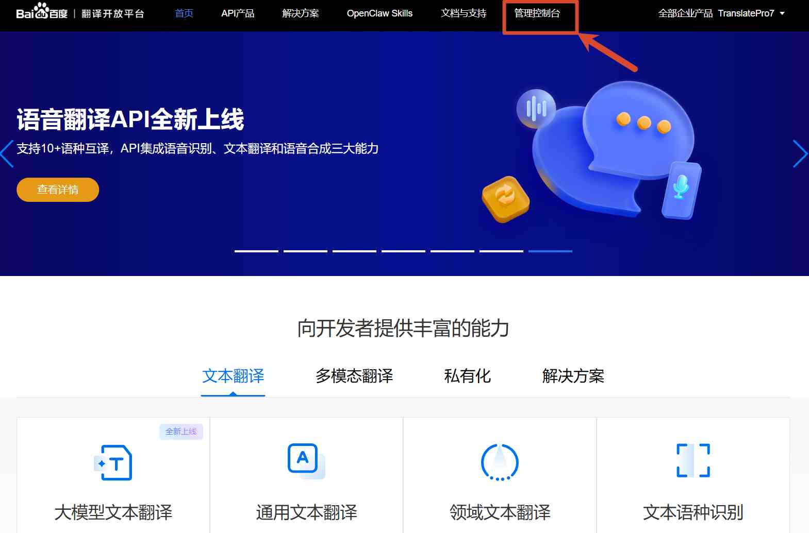
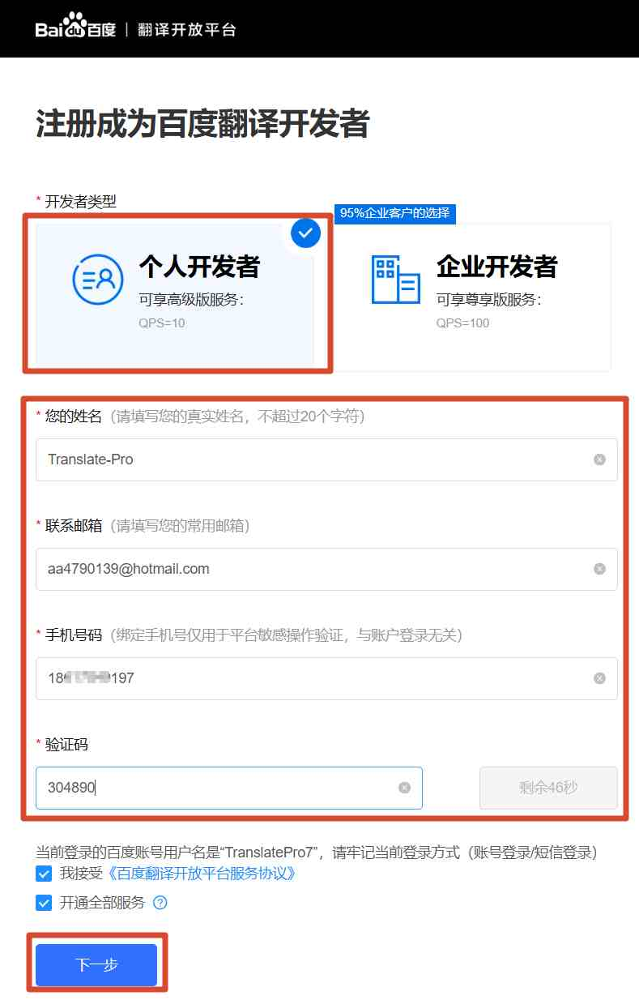
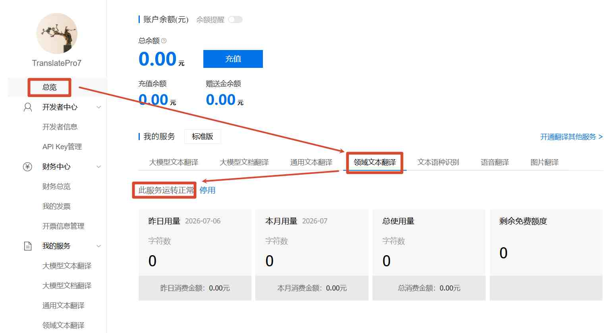
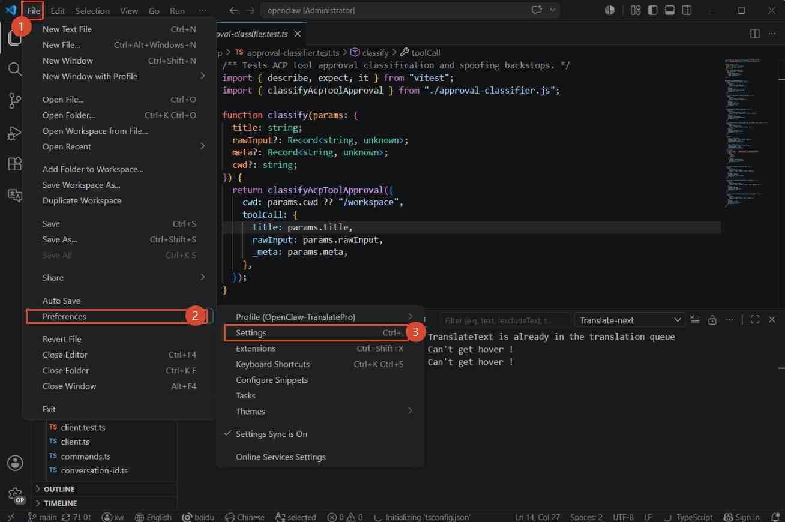
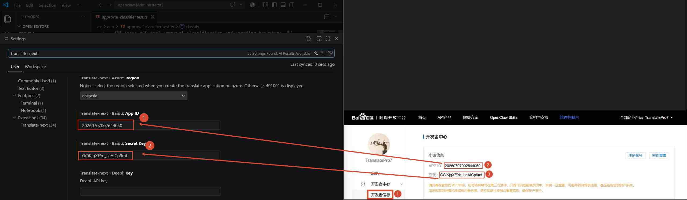
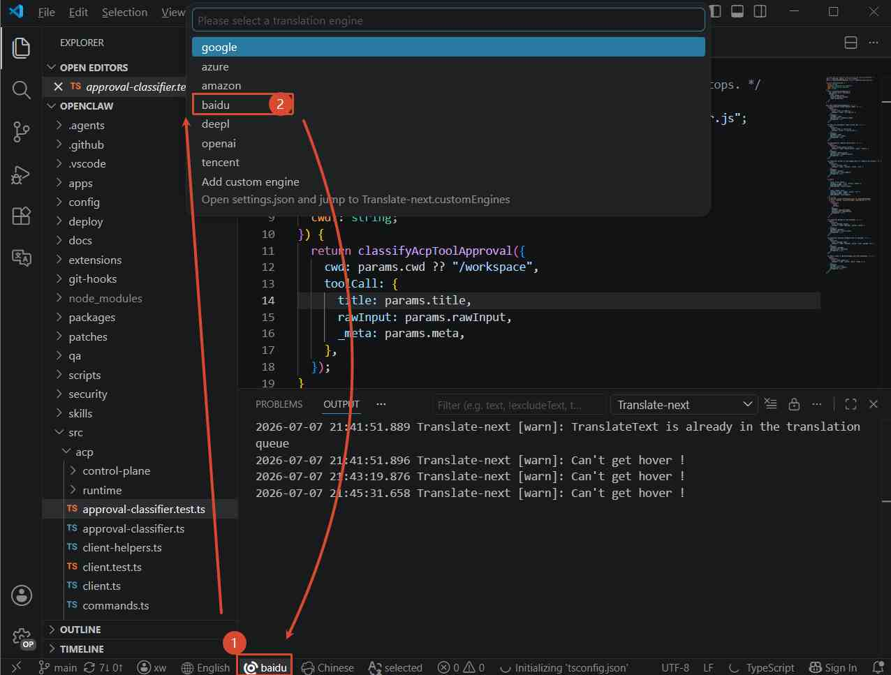

# Configure the Baidu Translation Engine

## ステップ 1：百度翻訳プラットフォームのアカウントを登録
公式サイト：[https://fanyi-api.baidu.com/](https://fanyi-api.baidu.com/)

## ステップ 2：百度の開発者として登録
1. 管理コンソールを開く
	
2. 百度の開発者として登録する
	

## ステップ 3：領域テキスト翻訳を有効化
- アカウントで「領域テキスト翻訳」が有効になっていることを確認してください。未有効の場合はご自身で有効化してください
	

## ステップ 4：VS Code の設定画面を開く
1. 設定画面を開く
	
2. 百度を設定：`Translate-next.baidu.appId` と `Translate-next.baidu.secretKey`
	

## ステップ 5：翻訳エンジンを `baidu` に切り替える

以上で設定は完了です。すぐに利用できます。

## 百度翻訳のよくあるエラー

 | エラーコード | 意味       | 解決方法                                                             |
 | ------------ | ---------- | -------------------------------------------------------------------- |
 | 52003        | 未認証ユーザー | appid が正しいか、サービスが有効化されているかを確認してください   |
 | 54003        | アクセス制限   | 有効化したサービスが汎用テキスト翻訳の可能性があります。領域翻訳サービスに変更してください |
	
> その他のエラーコードは [エラーコード一覧](https://api.fanyi.baidu.com/doc/22) を参照してください
