# カスタム翻訳エンジンの設定

Custom Engine の目的は、設定フィールドの仕様と翻訳 API のルールに従う限り、何を翻訳エンジンとして使うかをユーザーが完全に自由に定義できることです。

## DeepSeek の設定
1. 公式サイト [https://www.deepseek.com/](https://www.deepseek.com/) を開き、アカウントを登録
2. API 開発プラットフォームへ移動
  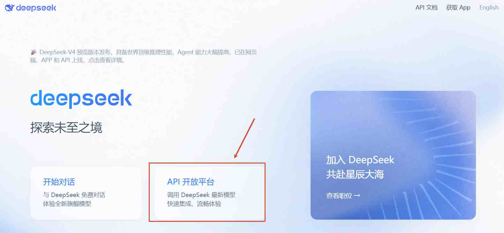
3. API キーを作成
  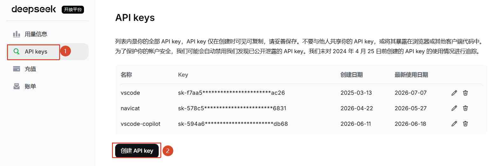
  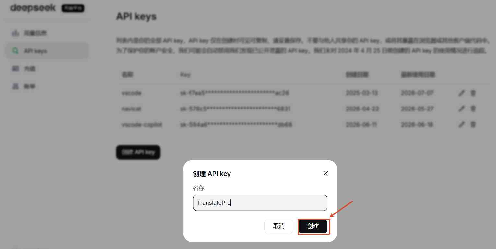
  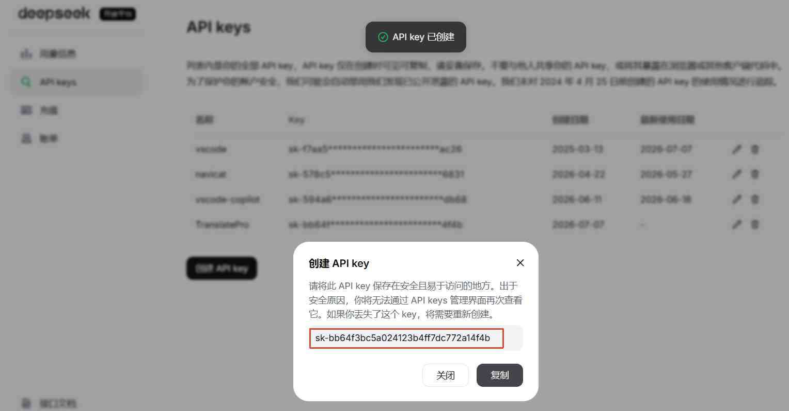

4. 拡張機能で DeepSeek Engine を設定
   Authorization をステップ 3 で作成した API キーに置き換えます
   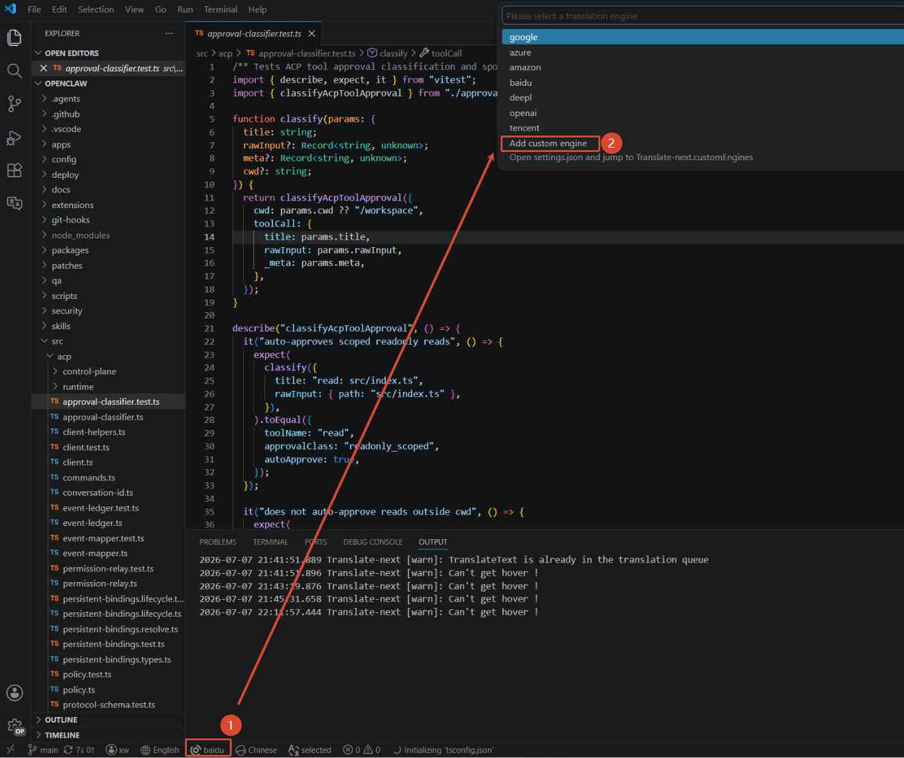
   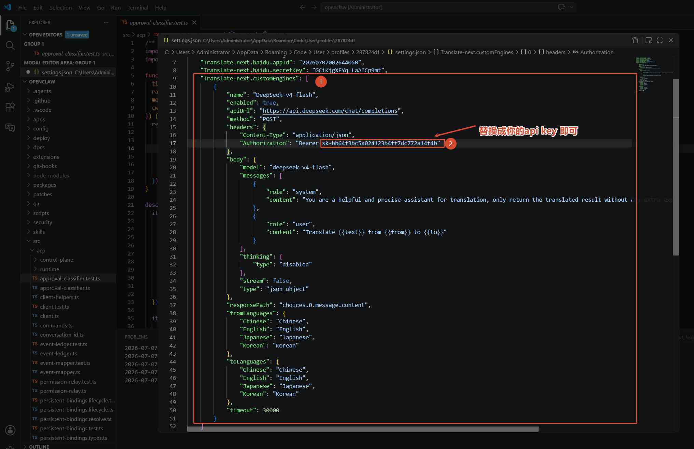

設定内容：

   ```json
   ...
    "Translate-next.customEngines": [
        {
            "name": "DeepSeek-v4-flash",
            "enabled": true,
            "apiUrl": "https://api.deepseek.com/chat/completions",
            "method": "POST",
            "headers": {
                "Content-Type": "application/json",
                "Authorization": "******"
            },
            "body": {
                "model": "deepseek-v4-flash",
                "messages": [
                    {
                        "role": "system",
                        "content": "You are a helpful and precise assistant for translation, only return the translated result without any extra explanation or comment"
                    },
                    {
                        "role": "user",
                        "content": "Translate {{text}} from {{from}} to {{to}}"
                    }
                ],
                "thinking": {
                    "type": "disabled"
                },
                "stream": false,
                "type": "json_object"
            },
            "responsePath": "choices.0.message.content",
            "fromLanguages": {
                "Chinese": "Chinese",
                "English": "English",
                "Japanese": "Japanese",
                "Korean": "Korean"
            },
            "toLanguages": {
                "Chinese": "Chinese",
                "English": "English",
                "Japanese": "Japanese",
                "Korean": "Korean"
            },
            "timeout": 30000
        }
    ]
   ...
   ```

補足：翻訳エンジンとしては `deepseek-v4-flash` で十分です。より高価な `deepseek-v4-pro` を使う必要はありません。

## Zhipu（智谱）の設定
1. 公式サイト [https://bigmodel.cn/](https://bigmodel.cn/) を開き、アカウントを登録
2. コンソールへ移動し、API キーを作成
  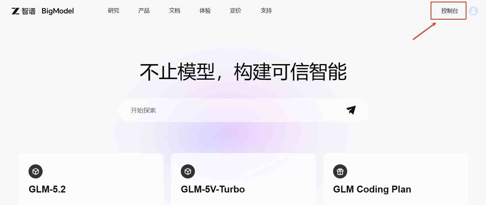
  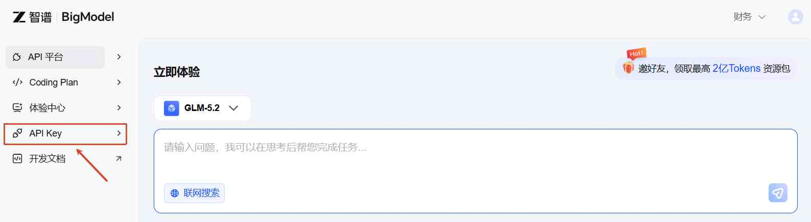
  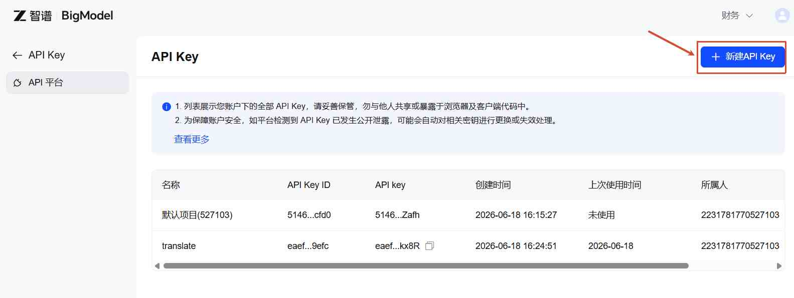
  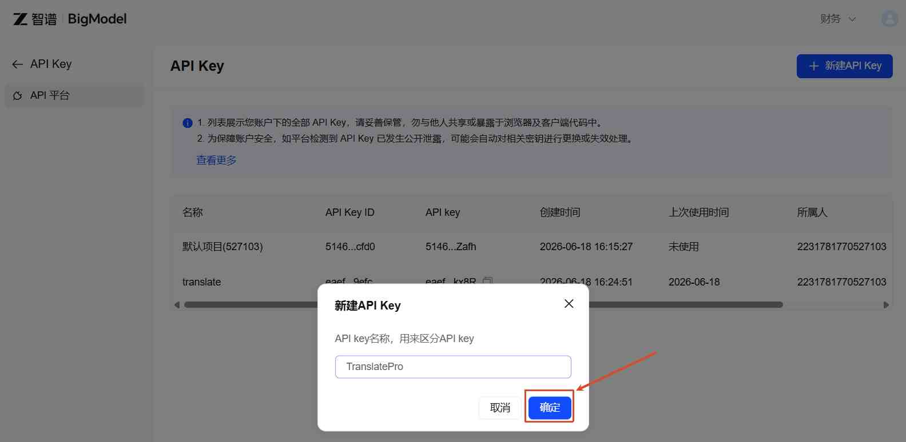
  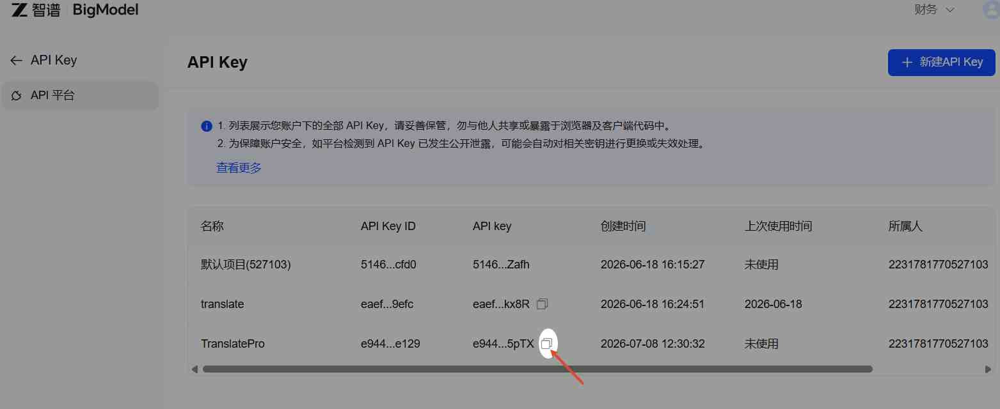
3. 拡張機能で Zhipu Engine を設定
  
  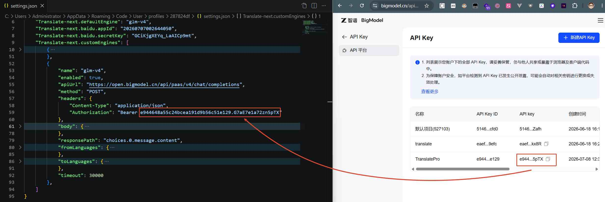

設定内容：

  ```json
  {
			"name": "glm-v4",
			"enabled": true,
			"apiUrl": "https://open.bigmodel.cn/api/paas/v4/chat/completions",
			"method": "POST",
			"headers": {
				"Content-Type": "application/json",
				"Authorization": "******"
			},
			"body": {
				"model": "glm-5.2",
				"messages": [
					{
						"role": "system",
						"content": "You are a helpful and precise assistant for translation, only return the translated result without any extra explanation or comment"
					},
					{
						"role": "user",
						"content": "Translate {{text}} from {{from}} to {{to}}"
					}
				],
				"thinking": {
					"type": "disabled"
				},
				"stream": false,
				"type": "json_object"
			},
			"responsePath": "choices.0.message.content",
			"fromLanguages": {
				"Chinese": "Chinese",
				"English": "English",
				"Japanese": "Japanese",
				"Korean": "Korean"
			},
			"toLanguages": {
				"Chinese": "Chinese",
				"English": "English",
				"Japanese": "Japanese",
				"Korean": "Korean"
			},
			"timeout": 30000
		}
  ```

## Qwen の設定
1. 公式サイト [https://www.aliyun.com/product/qwen?utm_content=se_1023450589](https://www.aliyun.com/product/qwen?utm_content=se_1023450589) を開き、アカウントを登録
2. API キーを作成
  ショートカット：[https://bailian.console.aliyun.com/cn-beijing?spm=5176.29597918.J_F4r-7Zs_PtjrjEY48APSA.d_primary.68a5133cchGM2U&tab=model#/api-key](https://bailian.console.aliyun.com/cn-beijing?spm=5176.29597918.J_F4r-7Zs_PtjrjEY48APSA.d_primary.68a5133cchGM2U&tab=model#/api-key)
3. 拡張機能で Qwen-plus Engine を設定
  
  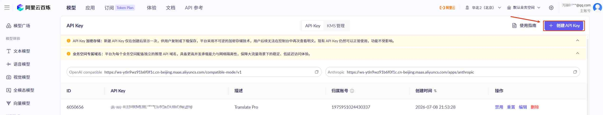
  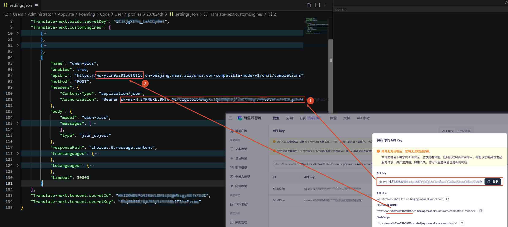

設定内容：

```json
...
  "Translate-next.customEngines": [
    ...
    {
			"name": "qwen-plus",
			"enabled": true,
			"apiUrl": "https://ws-ytln9wz91b6f0f1c.cn-beijing.maas.aliyuncs.com/compatible-mode/v1/chat/completions",
			"method": "POST",
			"headers": {
				"Content-Type": "application/json",
				"Authorization": "******"
			},
			"body": {
				"model": "qwen-plus",
				"messages": [
					{
						"role": "system",
						"content": "You are a helpful and precise assistant for translation, only return the translated result without any extra explanation or comment"
					},
					{
						"role": "user",
						"content": "Translate {{text}} from {{from}} to {{to}}"
					}
				],
				"type": "json_object"
			},
			"responsePath": "choices.0.message.content",
			"fromLanguages": {
				"Chinese": "Chinese",
				"English": "English",
				"Japanese": "Japanese",
				"Korean": "Korean"
			},
			"toLanguages": {
				"Chinese": "Chinese",
				"English": "English",
				"Japanese": "Japanese",
				"Korean": "Korean"
			},
			"timeout": 30000
		}
  ]

...
```

## 補足説明

### 設定手順の概要

1. VS Code の設定を開き、`Translate-next.customEngines` を検索します。
2. 新しいオブジェクトを追加し、`name`、`apiUrl`、`method`、`toLanguages` を入力します。
3. リクエストボディが必要なら `body`、クエリパラメータが必要なら `query`、リクエストヘッダーが必要なら `headers` を設定します。
4. `body`、`query`、`headers` の中で `{{from}}`、`{{to}}`、`{{text}}` のプレースホルダーが使えます。
5. 返却結果が JSON の特定フィールドにある場合は `responsePath` を設定します（例：`response`、`data.translation`、`choices[0].message.content`）。
6. 設定が完了したら、`defaultEngine` を設定したカスタムエンジン名に切り替えれば使用できます。

### 主なフィールドの説明
- `enabled`：このエンジンを有効にするかどうか。翻訳エンジン一覧の切り替えに使用します。注意：現在使用中のエンジンを `false` にすることはできません。
- `name`：カスタムエンジン名。一意である必要があります。
- `apiUrl`：エンドポイント URL。
- `method`：`GET` または `POST`。
- `headers`：リクエストヘッダー。
- `query`：URL クエリパラメータ。
- `body`：リクエストボディ。
- `responsePath`：レスポンス JSON から翻訳結果を取り出すパス。`choices[0].message.content` のような配列パスも使用でき、`choices` の 1 番目の要素の `message` 内の `content` を取得することを意味します。
- `fromLanguages`：原文言語のマッピング。key は言語名、value は言語コードです。
- `toLanguages`：翻訳先言語のマッピング。key は言語名、value は言語コードです。
- `batchStrategy`：任意。複数テキストのリクエストモードで、`none`、`join`、`array` に対応します。既定値：`none`。
- `joinDelimiter`：任意。`batchStrategy=join` のときの連結区切り文字。既定値：`undefined`。
- `timeout`：リクエストのタイムアウト時間（ミリ秒）。既定値：`30000`。

### 例：ローカルで ollama を使って翻訳 LLM をエンジンとして動かす

説明：翻訳用の LLM をローカルで動かすには GPU が必要です。GPU がないと翻訳品質が大きく低下します（低速・不正確）。

```json
"Translate-next.customEngines": [
  {
    "enabled": true,
    "name": "my-ollama",
    "apiUrl": "http://localhost:11434/api/generate",
    "method": "POST",
    "headers": {
      "Content-Type": "application/json"
    },
    "body": {
      "model": "translategemma:4b",
      "prompt": "{{text}} を {{from}} から {{to}} に翻訳してください",
      "stream": false
    },
    "responsePath": "response",
    "fromLanguages": {
      "Chinese": "zh",
      "English": "en",
      "Japanese": "ja",
      "Korean": "ko"
    },
    "toLanguages": {
      "Chinese": "zh",
      "English": "en",
      "Japanese": "ja",
      "Korean": "ko"
    },
    "timeout": 30000
  }
]
```

レスポンス例：

```json
{
  "response": "こんにちは、世界！"
}
```

このような API では `responsePath: "response"` を設定するだけで十分です。

この設定ルールを理解すれば、あらゆるカスタムエンジンを自由に構成できます。
