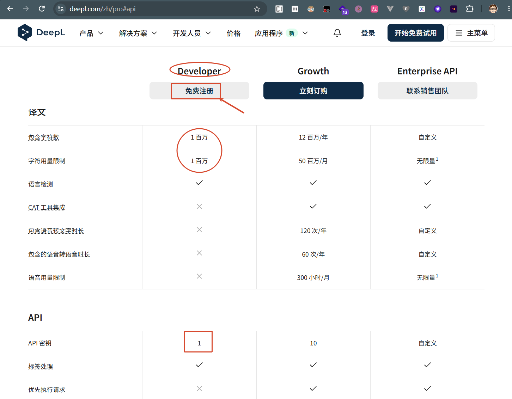
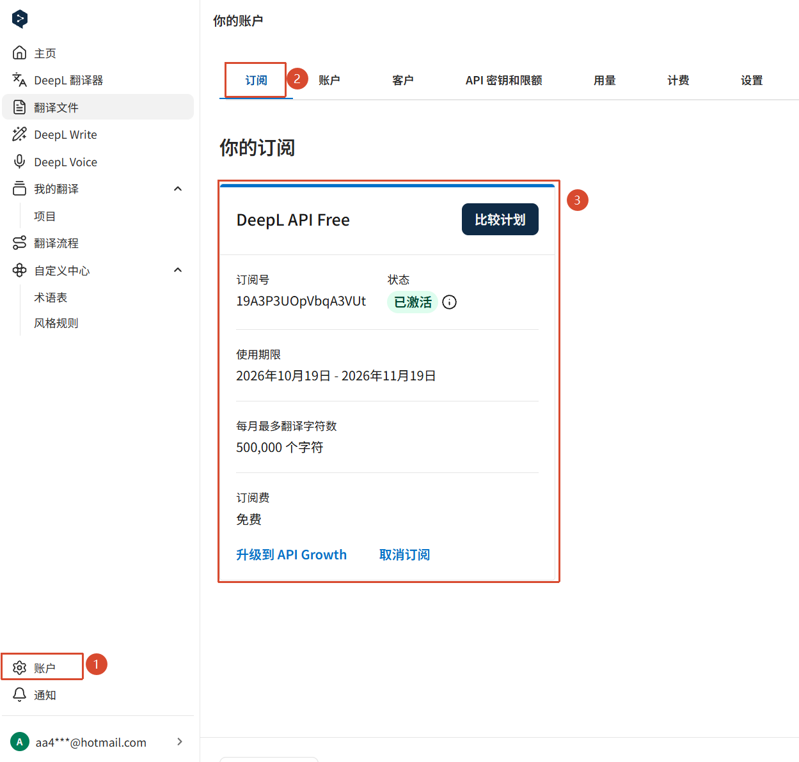
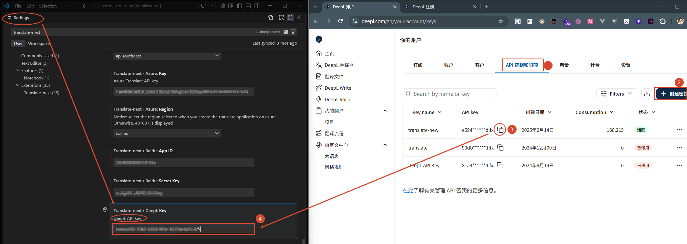

# 配置Deepl翻译Engine

# 第1步：注册Deepl账号
官网地址: [https://www.deepl.com/](https://www.deepl.com/)

## 第2步：注册Developer 账号

## 第3步：订阅DeepL API Free

> 提示：需要VISA 信用卡，如果没有可以网上搜索“海外虚拟VISA信用卡”购买(中国大陆信用卡可能使用不了)

## 第4步：创建API密码

将密钥copy 至Translate-Pro setting -> Deepl API Key

至此配置已完成，可以正常使用了。
